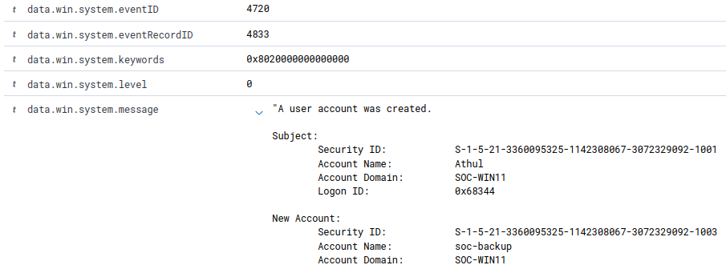
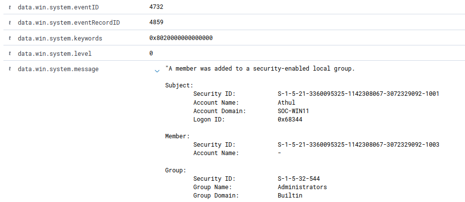

# SOC-003: Suspicious Account Creation and Privileged Group Assignment

## Investigation Overview

This investigation examines the creation of a new Windows local user account followed by its addition to the local Administrators group.

The objective was to identify potentially unauthorized privileged account creation, correlate Windows Security events, and determine whether the activity represented a security incident.

**Investigation Status:** Completed  
**Disposition:** Benign — Authorized Lab Simulation

---

## Lab Environment

| Component | Technology |
|---|---|
| SIEM | Wazuh |
| Endpoint | Windows 11 |
| Hostname | SOC-WIN11 |
| Virtualization | KVM/QEMU |
| Log Source | Windows Security Event Log |

---

## Investigation Scenario

A new local user account was created on the monitored Windows endpoint.

Shortly afterward, the account was added to the local Administrators group.

In a production environment, this sequence could indicate an attacker creating a privileged account to maintain access to a compromised system.

The activity was intentionally generated in a controlled SOC home lab.

---

## Detection and Timeline

Two Windows Security events were collected and analyzed.

| Timestamp | Event ID | Activity |
|---|---|---|
| 2026-10-08 12:17:11.167 | 4720 | Local account `soc-backup` created |
| 2026-10-08 12:17:51.759 | 4732 | Account added to Administrators group |

**Time between events: 40.592 seconds**

### Event 4720 — User Account Created

The event showed:

- Subject Account Name: `Athul`
- New Account Name: `soc-backup`
- Endpoint: `SOC-WIN11`



### Event 4732 — Security Group Membership Changed

The event showed:

- Subject Account Name: `Athul`
- Group Name: `Administrators`
- Member SID: `S-1-5-21-3360095325-1142308067-3072329092-1003`



---

## Investigation and Analysis

### 1. Account Creation

Windows Security Event ID 4720 confirmed that a new local account named `soc-backup` was created.

The subject account responsible for this action was `Athul`.

### 2. Privileged Group Assignment

Windows Security Event ID 4732 showed that an account was added to the local Administrators group approximately 40.6 seconds after account creation.

Membership in this group grants significant administrative privileges on the Windows endpoint.

### 3. SID Correlation

The member SID recorded in Event 4732 was:

`S-1-5-21-3360095325-1142308067-3072329092-1003`

The following PowerShell command was used to verify the account identity:

```powershell
Get-LocalUser -Name "soc-backup" | Select-Object Name, SID
```

The command returned the same SID for `soc-backup`.

This confirmed that the newly created account was the account added to the Administrators group.

### 4. Security Assessment

The sequence of events was consistent with privileged account creation:

1. A local user account was created.
2. The account was added to the Administrators group.
3. Both actions were performed by the same existing user.
4. The actions occurred approximately 40.6 seconds apart.

Such activity could represent unauthorized account creation or persistence if performed without approval.

In this case, the activity was intentionally generated as part of the SOC lab.

---

## MITRE ATT&CK Mapping

| Technique | Description |
|---|---|
| T1136.001 | Create Account: Local Account |
| T1098.007 | Account Manipulation: Additional Local or Domain Groups |

These techniques describe behavior relevant to the simulated scenario. Their inclusion does not imply that a real attack occurred.

---

## Conclusion

**Final Disposition: Benign — Authorized Lab Simulation**

The investigation successfully correlated Windows Security Events 4720 and 4732 to identify a newly created account that was subsequently granted local administrative privileges.

Account SID verification confirmed that both events referred to the same account.

This exercise demonstrated how Windows Security logs and Wazuh can be used to investigate potentially suspicious account management activity.

---

## Skills Demonstrated

- Windows Security Event Log analysis
- Wazuh SIEM investigation
- Event ID 4720 analysis
- Event ID 4732 analysis
- Security Identifier (SID) correlation
- Privileged account monitoring
- Authentication and account management investigation
- MITRE ATT&CK mapping
- Security incident triage
- Evidence-based incident classification
