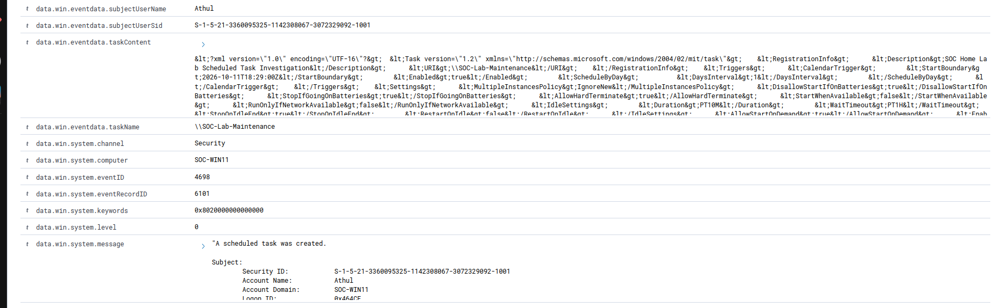
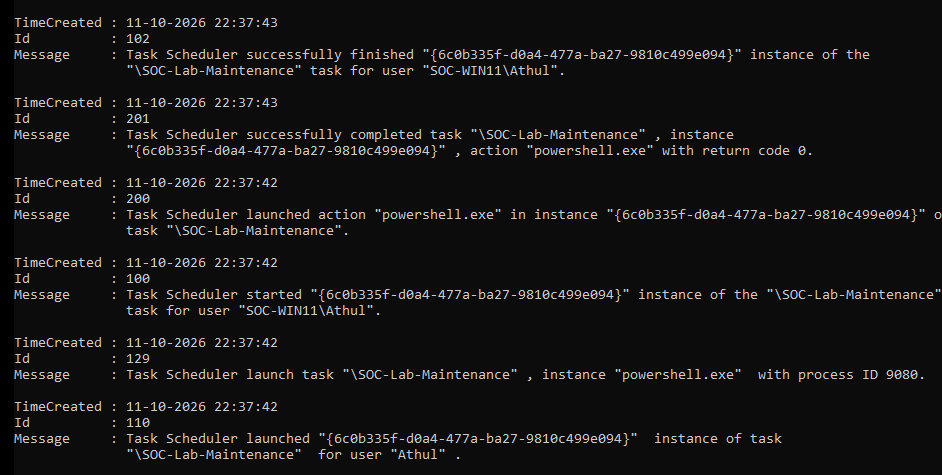
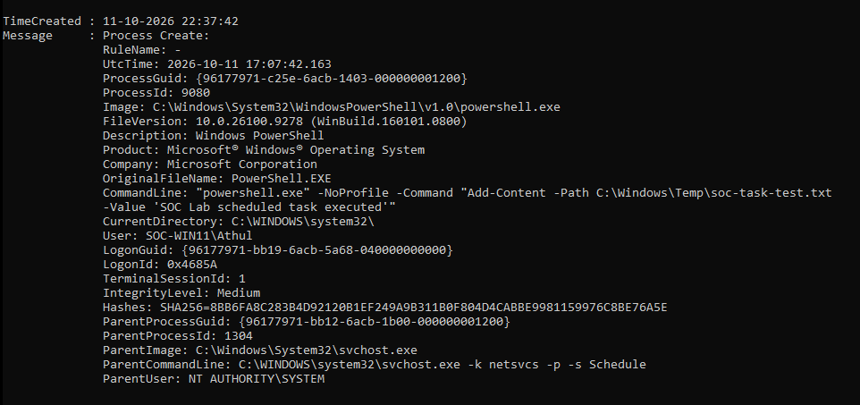

# SOC-004: Windows Scheduled Task Persistence Investigation

## Investigation Overview

This investigation examines the creation and execution of a Windows scheduled task that launches PowerShell.

Scheduled tasks are commonly used for legitimate system administration. However, attackers may abuse them to execute malicious commands or maintain persistence on compromised endpoints.

The objective was to identify scheduled task creation, reconstruct the execution timeline, correlate process activity using Sysmon, and determine whether the activity represented a security incident.

**Investigation Status:** Completed  
**Final Disposition:** Benign — Authorized Lab Simulation  
**MITRE ATT&CK:** T1053.005 — Scheduled Task/Job: Scheduled Task

---

## Lab Environment

| Component | Technology |
|---|---|
| SIEM | Wazuh |
| Endpoint | Windows 11 |
| Hostname | SOC-WIN11 |
| Virtualization | KVM/QEMU |
| Endpoint Monitoring | Wazuh Agent |
| Process Monitoring | Sysmon |
| Log Sources | Windows Security, Task Scheduler Operational, Sysmon |

---

## Investigation Scenario

A Windows scheduled task named `SOC-Lab-Maintenance` was configured to execute PowerShell.

The task executed a harmless command that appended a message to a text file.

This simulated a scheduled-task execution pattern that could warrant investigation in a production environment.

All actions were performed intentionally within an isolated SOC home lab.

### Scheduled Task Configuration

**Task Name:** `SOC-Lab-Maintenance`

**Executable:** `powershell.exe`

**Command:**

```powershell
powershell.exe -NoProfile -Command "Add-Content -Path C:\Windows\Temp\soc-task-test.txt -Value 'SOC Lab scheduled task executed'"
```

**Expected Behavior:** Append a test message to a local text file.

---

## Detection and Evidence

### 1. Scheduled Task Creation — Event ID 4698

Windows Security Event ID 4698 records scheduled task creation.

This event was observed during the investigation.

The scheduled task was named:

`SOC-Lab-Maintenance`



### 2. Scheduled Task Execution

Windows Task Scheduler Operational logs were examined to reconstruct the execution timeline.



### Execution Timeline

| Timestamp | Event ID | Description |
|---|---|---|
| 2026-10-11 22:36:00 | 141 | Previous task with the same name deleted |
| 2026-10-11 22:37:17 | 106 | Scheduled task registered |
| 2026-10-11 22:37:42 | 325 | Task instance queued |
| 2026-10-11 22:37:42 | 110 | Task instance launched |
| 2026-10-11 22:37:42 | 100 | Task started |
| 2026-10-11 22:37:42 | 129 | PowerShell process launched |
| 2026-10-11 22:37:42 | 200 | Task action started |
| 2026-10-11 22:37:43 | 201 | Task action completed successfully |
| 2026-10-11 22:37:43 | 102 | Task completed |

*The timestamps above are from Windows Event Viewer in the endpoint's local time.*

The logs confirmed that the scheduled task launched PowerShell and completed successfully.

Event ID 129 identified the launched process as PID `9080`.

Event ID 201 reported return code `0`.

---

## Sysmon Process Investigation

Sysmon Event ID 1 was used to investigate the PowerShell process created by Task Scheduler.



### Process Details

| Field | Value |
|---|---|
| Event ID | 1 |
| Timestamp (UTC) | 2026-10-11 17:07:42.163 |
| Process ID | 9080 |
| Process Image | `C:\Windows\System32\WindowsPowerShell\v1.0\powershell.exe` |
| Parent Process ID | 1304 |
| Parent Image | `C:\Windows\System32\svchost.exe` |
| User | `SOC-WIN11\Athul` |
| Integrity Level | Medium |
| SHA256 | `8BB6FA8C283B4D92120B1EF249A9B311B0F804D4CABBE9981159976C8BE76A5E` |

### Process GUID

```text
{96177971-c25e-6acb-1403-000000001200}
```

### Parent Process Command Line

```text
C:\WINDOWS\system32\svchost.exe -k netsvcs -p -s Schedule
```

This identified the Windows Task Scheduler service as the parent process responsible for launching PowerShell.

### PowerShell Command Line

```powershell
"powershell.exe" -NoProfile -Command "Add-Content -Path C:\Windows\Temp\soc-task-test.txt -Value 'SOC Lab scheduled task executed'"
```

The command matched the scheduled task configuration.

---

## Parent-Child Process Analysis

Sysmon revealed the following process relationship:

```text
svchost.exe
PID: 1304
Service: Schedule
User: NT AUTHORITY\SYSTEM
        |
        v
powershell.exe
PID: 9080
User: SOC-WIN11\Athul
        |
        v
conhost.exe
PID: 6148
User: SOC-WIN11\Athul
```

The PowerShell process was created by the Windows Task Scheduler service.

A subsequent Sysmon event showed `conhost.exe` being launched as a child of PowerShell.

This parent-child relationship was consistent with the expected execution of the scheduled task.

---

## Event Correlation

The investigation correlated events from multiple Windows logging sources.

### Windows Security

Event ID 4698 established that a scheduled task was created.

### Task Scheduler Operational

Events 106, 100, 129, 200, 201, and 102 established the task registration and execution sequence.

### Sysmon

Event ID 1 provided detailed process information, including:

- Process ID
- Process GUID
- Executable path
- Command line
- Parent process
- User context
- File hash

### Correlation Finding

Task Scheduler Event ID 129 and Sysmon Event ID 1 both identified PowerShell process ID `9080`.

The process command line also matched the scheduled task's configured action.

This established a strong correlation between the scheduled task and the observed PowerShell execution.

---

## SIEM Visibility

Wazuh was configured to collect Windows Security, Sysmon, and Task Scheduler Operational event channels.

During the investigation, the relevant Task Scheduler and Sysmon execution events were verified in Windows Event Viewer.

However, the corresponding execution events were not located in Wazuh Threat Hunting.

Wazuh Threat Hunting primarily displays events that generate alerts. Therefore, the absence of these events from the alert view does not establish whether they were received by the Wazuh manager.

Raw-event ingestion was not independently confirmed for these specific records.

Windows Event Viewer and Sysmon were used as the primary evidence sources for the execution timeline.

---

## Security Analysis

The observed activity included:

1. Creation of a Windows scheduled task.
2. Registration of the task by a local user.
3. Execution of PowerShell through Task Scheduler.
4. Creation of a PowerShell process by the Schedule service.
5. Successful execution of the configured command.
6. Creation of the expected output in a local text file.

Scheduled tasks can be abused by attackers for persistence or recurring execution.

However, the presence of a scheduled task or PowerShell execution is not sufficient to establish malicious activity.

In this investigation, the task was intentionally created and executed as part of authorized testing.

---

## MITRE ATT&CK Mapping

| Technique ID | Technique |
|---|---|
| T1053.005 | Scheduled Task/Job: Scheduled Task |

The technique describes behavior relevant to the simulation and does not indicate that an actual attack occurred.

---

## Investigation Conclusion

**Final Disposition: Benign — Authorized Lab Simulation**

The investigation successfully reconstructed the creation and execution of a Windows scheduled task.

Windows Task Scheduler logs confirmed that the task executed PowerShell successfully.

Sysmon Event ID 1 provided additional evidence of the PowerShell process, its parent process, and its command line.

Correlation using process ID `9080` connected the Task Scheduler execution event to the Sysmon process-creation event.

The observed behavior was consistent with the authorized lab activity.

---

## Skills Demonstrated

- Windows Scheduled Task investigation
- Windows Security Event Log analysis
- Task Scheduler Operational log analysis
- Sysmon Event ID 1 analysis
- PowerShell process investigation
- Parent-child process correlation
- Process ID and Process GUID analysis
- Event timeline reconstruction
- Wazuh SIEM investigation
- MITRE ATT&CK mapping
- Evidence-based incident classification

---

## Key Takeaway

Scheduled task execution can be a legitimate administrative activity or a potential persistence mechanism.

A reliable investigation requires correlating task creation, execution history, process telemetry, and the operational context before determining whether the activity is malicious.
